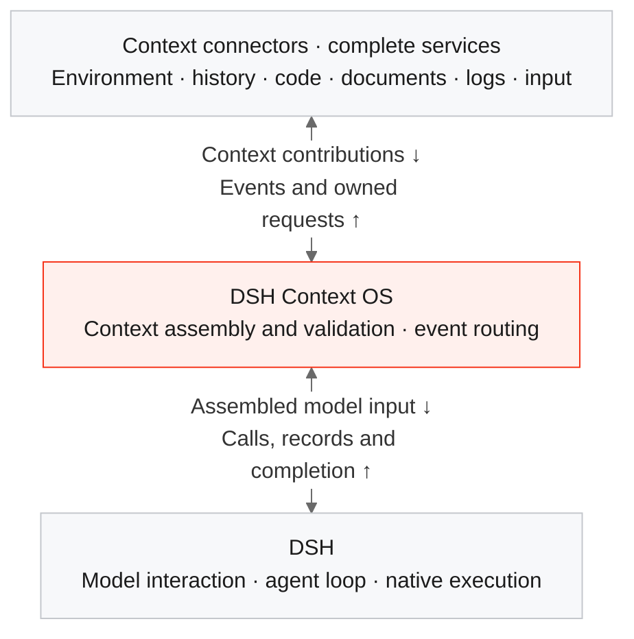

# DSH Context OS

English | [简体中文](README.zh-CN.md)

> **ReAct is all you need.**  
> **Everything is a context connector.**

**Compose each agent run from complete, replaceable resource services.**

DSH Context OS is a plugin for [DeepSeek Harness](https://github.com/deepseek-ai/deepseek-harness). Choose the environment, code, conversation history, documents and other services for this run. Each service supplies context and handles the interactions it owns. The framework composes their contributions around the agent loop.

[ReAct](https://react-lm.github.io/) combines reasoning and acting. Our slogan expresses an architectural thesis: keep that loop general, and make its connection to the world composable.

**Status:** experimental `0.1.0`. The composition runtime and drag-and-drop Web UI work today. The complete mode uses the included launcher with a pinned DSH build. Service-wide resource auditing and agent-assisted configuration are next steps. See [current scope](#current-scope).

## Start with the run

Many agent products organize everything around a workspace, a persistent session, a skill directory or a fixed set of tools. Those are useful product choices. They also become architectural assumptions: where files live, how history is restored, which instructions are loaded, and how outside services can respond.

We choose a smaller foundation: **an agent loop running with a particular context composition**.

For a given model and runtime configuration, the context assembled for the model—and the information and capabilities it can reach—are central product variables. Context includes instructions, history, task input, capability descriptions and observations returned from the world. Improving it means supplying the right information at the right time, with access to the right resources.

This leads to two responsibilities:

- **The framework defines how context is composed and how events are delivered.**
- **Service providers decide what to contribute, when to contribute it, and how their resources work.**

A document platform can offer guidance, search, editing, permissions and persistence together. An input method, a log stream or a history recommender can participate through the same boundary. Skill and MCP remain useful integration formats; they do not define the framework's service model.

This project develops the proposal in [Context assembly and feedback as the framework boundary](https://github.com/weijiafu14/dsh/blob/main/articles/02-context-connectors.md).

## Three layers, one feedback loop



**One connector owns one complete service.** Its instructions, callable capabilities, execution feedback, persistence and cleanup stay together. A sandbox service can contribute system guidance and file/shell capabilities through the same protocol as a document service contributes editing guidance and document operations.

The framework owns contribution identity, ordering, validation and assembly. DSH owns the native loop. Construction and service dependencies use DSH/Cordis; a repository provider that needs an execution provider uses those existing dependency mechanisms.

A run follows the same path for every service:

1. Selected connectors initialize and contribute instructions, capabilities and, where applicable, coherent history.
2. Before each model step, the framework combines their current contributions into the next input.
3. The model requests an operation. The framework routes it to the connector that owns it.
4. That service operates on its resources and returns an answer, possibly with updated context for a later step.
5. Records and settlement events return to the services for persistence and cleanup. They can also contribute context for subsequent work.

The same boundary supports both initial assembly and ongoing feedback. Loading knowledge on demand, receiving a new log entry and returning a tool result all fit into it.

## Why this changes what products can do

### Replace the execution environment as a complete service

Moving a coding agent from a host machine to a sandbox is difficult when file reads, file writes, directory inspection, environment checks, shell execution and workspace instructions are spread across the agent's implementation. Redirecting commands alone can leave filesystem checks or environment descriptions pointing at the original host.

With Context OS, an execution provider owns this whole resource boundary:

| Responsibility | What the environment connector supplies |
| --- | --- |
| Describe the environment | System or user context explaining paths, available software and operating constraints |
| Inspect and change resources | Callable descriptions and implementations for its file, directory and command operations |
| Return observations | Results and context updates from the environment actually used |
| Manage the lifecycle | Provisioning or attachment, provider-side authorization, cancellation handling and release |

Switching from a local provider to a sandbox provider changes the selected service. The core still composes instructions and routes owned requests. Compatible repository and document services keep their contracts; dependencies remain explicit.

**The migration becomes an implementation of the environment service contract, with a smaller change surface and reusable tests.** The provider still implements the actual isolation, resource access and lifecycle. Merely describing a sandbox in a prompt does not create one.

### Continue a conversation across machines

When persistence and resume logic are inseparable from a coding agent, continuing elsewhere can require moving local session files, reproducing directory layouts and adapting the agent's recovery path.

Here, selected history is one source of context. A session provider loads it, converts it to the accepted representation, receives new records and persists the result. Its backend can be local storage or a remote service.

Continuation becomes:

```text
Choose history + choose this run's services + start the loop
```

That makes it possible to keep a shared history service while changing machines or execution environments, or to reuse the same starting history with a different set of resources. DSH still maintains the active loop's working state; the provider owns where persistent history comes from and where it goes.

For example, a provider built on this contract can save a laptop run to shared storage, then load that history on another machine for a run using a cloud sandbox. History transfer belongs to the session service; access to the new execution resources belongs to the environment service.

A portable session needs coherent call/result relationships, required attachments and resolvable resource references. The provider owns those details. The current runtime accepts one coherent native replay history; multiple conversations can be supplied as reference material after provider-side conversion. Live process migration and conflict-free concurrent synchronization require additional service implementations.

### Let users configure the run itself

Users should be able to choose combinations such as:

| Run | Selected services |
| --- | --- |
| Fix a bug | Task input + repository + sandbox + selected history |
| Review a design | Task input + team documents + architecture knowledge + history |
| Investigate an incident | Task input + log source + code service + incident history |
| Explore an alternative | The same starting history + a different execution or document service |

The Web composer already supports dragging available connectors into a run, editing their configuration and starting a separate native DSH conversation. Developers can construct the same composition through the core API. Agent-assisted selection is a planned way to produce that configuration.

“Any combination” means any compatible selection: dependencies, permissions and contribution conflicts still apply. Sources may update the context during a run; replacing the selected connector set creates a new composition.

### Make services independently useful—and changes easier to verify

A provider can own authentication, permission checks, resource versions, quotas and usage measurement alongside its read/write operations. It can expose a whole service without squeezing its lifecycle into a skill file or tool description. The framework supplies a consistent integration boundary.

That also makes changes more local. Replace one service, hold the others constant, and verify the same user scenario. The repository tests exercise this by switching a complete service between local files and HTTP while keeping the framework and other connectors unchanged.

An architecture knowledge service can maintain module responsibilities, data flows and invariants as a shared map for humans and agents. Service contracts and their validation can then reflect actual reliability, latency and cost requirements, while people set the business priorities and acceptable risk.

This follows the engineering goals in [Architecture for AI-driven development](https://github.com/weijiafu14/dsh/blob/main/articles/01-architecture.md): explicit responsibilities, smaller change surfaces, realistic validation and replayable cases. Captured inputs, contributions and outcomes can support a growing regression corpus; identical configurations alone do not guarantee identical model outputs.

## Visibility, resource accounting and context limits

The intended product contract is understandable before, during and after a run: which services are selected, what they contribute, and which resources they read or change. Context should be inspectable as part of the run configuration, alongside the task and model settings.

The current framework attributes contributions and owned calls to connector instances. Providers can record their own operations. A unified read/write ledger, shared billing protocol and interception of arbitrary shell/network side effects are **future work**. For example, a Git service can report a pull as a read of its remote repository and a push as a write; the pull can still write a local working copy. Attribution must specify the resource concerned.

Context-window limits remain. A connector can contribute a small index and retrieve detailed material only when needed; the model need not receive every resource in full at startup. Budgeting, selection and compaction policy belong at the runtime boundary and can evolve independently of resource services. Today the underlying runtime provides compaction; Context OS does not yet expose a general pluggable budget/compaction policy.

This is what **OS** means in the project: a common boundary between the loop and resource services, where composition policies can evolve while providers keep their own responsibilities.

## A small connector protocol

A connector implements `{ id, events, handle(event) }`. The five runtime events are:

| Event | Meaning |
| --- | --- |
| `run/initialize` | Initialize the selected composition; contribute starting context and history |
| `agent/prepare-step` | Refresh context before the next model step |
| `tools/execute` | Execute an operation owned by this connector and answer its request |
| `session/event` | Observe a durable native record; save it or contribute future context |
| `run/settled` | Finish per-turn work; `closing: true` also marks final resource release |

Sources can additionally use their own names, such as `documents/changed` or `logs/new`. A log source does not have to pretend that a user sent a chat message to deliver an event.

Handlers return four kinds of contribution:

| Operation | Meaning |
| --- | --- |
| `put` | Set or update an owned current instruction, callable description or execution projection |
| `remove` | Withdraw an owned current contribution |
| `append` | Add input messages; during initialization, provide coherent native replay records |
| `answer` | Return the result of the connector's own pending request |

The framework combines instruction fragments by role and preserves call/result relationships. Fragment keys are scoped to their connector, selection order is stable, and conflicting callable names, replay owners or execution projections are rejected. Providers convert their own business formats. Natural-language contradictions still require sensible service configuration.

A current-state update affects the next prepared request. `put/remove` can invalidate an earlier cache prefix; `append` explicitly grows the history. Records remain immutable, and settlement feedback does not silently start another model turn.

For an existing run containing the [complete document service](examples/documentService.ts):

```typescript
const receipt = await run.send(
  'documents/changed',
  { policy: 'Use the updated review policy.' },
  'documents',
);
await receipt.completed;
```

`send()` always acknowledges admission. `completed` waits for execution, child work and persistence. The full example keeps instructions, lazy guidance, reads, writes, record collection, saving and cleanup in one connector. See the [protocol and integration reference](docs/protocol.md) for registration, ownership, concurrency and host integration.

## Current scope

| Available in this release | Provided by an integration or planned next |
| --- | --- |
| Unified events and context contributions; scoped ownership and conflict checks | A common resource-effect ledger and arbitrary network/shell interception |
| Drag-and-drop DSH Web composer and reusable host UI | Agent-assisted connector selection |
| Native adapters for execution tools, skills, MCP, session history and subagents; PTC projection | Production-specific sandbox, remote session and enterprise service backends |
| Standalone framework entry and complete document-service example | General context budgeting/compaction plugins |
| Validated update, removal, cold replay, service replacement and persistence behavior | Live cross-machine process migration and multi-writer session synchronization |

Skill and MCP adapters preserve existing integrations. New services can use the connector protocol directly. Host security policies and provider authorization remain necessary; this package does not isolate untrusted plugin code or automatically account for every effect of a shell command.

## Install and run

Requirements: **Node.js 24.9+** and a prebuilt DSH checkout at [`22ddee3792402c3e70ec5f86a63c3e3e895a2f60`](https://github.com/deepseek-ai/deepseek-harness/tree/22ddee3792402c3e70ec5f86a63c3e3e895a2f60), carrying version label `0.2.1-rc.3`. A matching npm version label alone is insufficient. The initial release is `dsh-context-os@0.1.0`.

Install from npm into the compatible DSH Web profile:

```sh
dsh plugin --profile web add dsh-context-os@0.1.0 --ignore-scripts --config.auto-install-peers=false -w
"${DSH_HOME:-$HOME/.dsh}/profiles/web/node_modules/.bin/dsh-context-os" --dsh-root /absolute/path/to/pinned/deepseek-harness --profile web
```

[GitHub releases](https://github.com/weijiafu14/dsh-context-os/releases) also provide the plugin tarball and standalone source archive. To build a package yourself, run from this source directory:

```sh
DSH_SOURCE_ROOT=/absolute/path/to/pinned/deepseek-harness npm run build
npm pack
```

Install the resulting package into the compatible DSH Web profile:

```sh
dsh plugin --profile web add /absolute/path/dsh-context-os-0.1.0.tgz --ignore-scripts --config.auto-install-peers=false -w
"${DSH_HOME:-$HOME/.dsh}/profiles/web/node_modules/.bin/dsh-context-os" --dsh-root /absolute/path/to/pinned/deepseek-harness --profile web
```

The launcher loads the version-checked preparation/admission bridge before DSH starts. It leaves the DSH installation files intact. Use this launcher for the complete event-driven mode. In the Web UI, open **上下文组合**, select connectors, enter a task and start the run.

Public entries: `dsh-context-os` for the DSH plugin, `/core` for composition, `/compat` for legacy adapters, and `/ui` for the React composer. DSH supplies the runtime peer packages; the shared UI supports React 18 and 19. The plugin uses the Web/desktop client contract; a packaged Electron distribution has not been separately validated.

## Development and evidence

```sh
DSH_SOURCE_ROOT=/absolute/path/to/pinned/deepseek-harness npm run verify
npm run export:source
```

The standalone source archive has been built outside the integrating application. Its 51 package tests cover composition, actual DSH execution, instruction replacement/removal, replay, cancellation, persistence, live feedback and service replacement. Tests requiring the native bridge run separately rather than being counted as successful skips. Consumer type checks also pass.

Installed-package browser validation covers DSH Web drag-and-drop, custom providers, skills, MCP, cold history and PTC. The same composer has also been exercised through JoyGen's WebSocket/runtime/storage integration. These validations use deterministic model responses and local enterprise endpoint fixtures; they execute the actual runtime, tools and browser. They do not establish live enterprise authorization or every provider's behavior.

## Origins and license

- [ReAct: Synergizing Reasoning and Acting in Language Models](https://react-lm.github.io/)
- [DeepSeek Harness: Everything is a Plugin](https://github.com/deepseek-ai/deepseek-harness)
- [Context assembly and feedback as the framework boundary](https://github.com/weijiafu14/dsh/blob/main/articles/02-context-connectors.md)
- [Architecture for AI-driven development](https://github.com/weijiafu14/dsh/blob/main/articles/01-architecture.md)

[MIT](LICENSE). The DSH-derived bridge retains its upstream license and modification notices; see [NOTICE](NOTICE) and `dist/runtime/LICENSE.dsh`. DSH Context OS is an independent community project.
