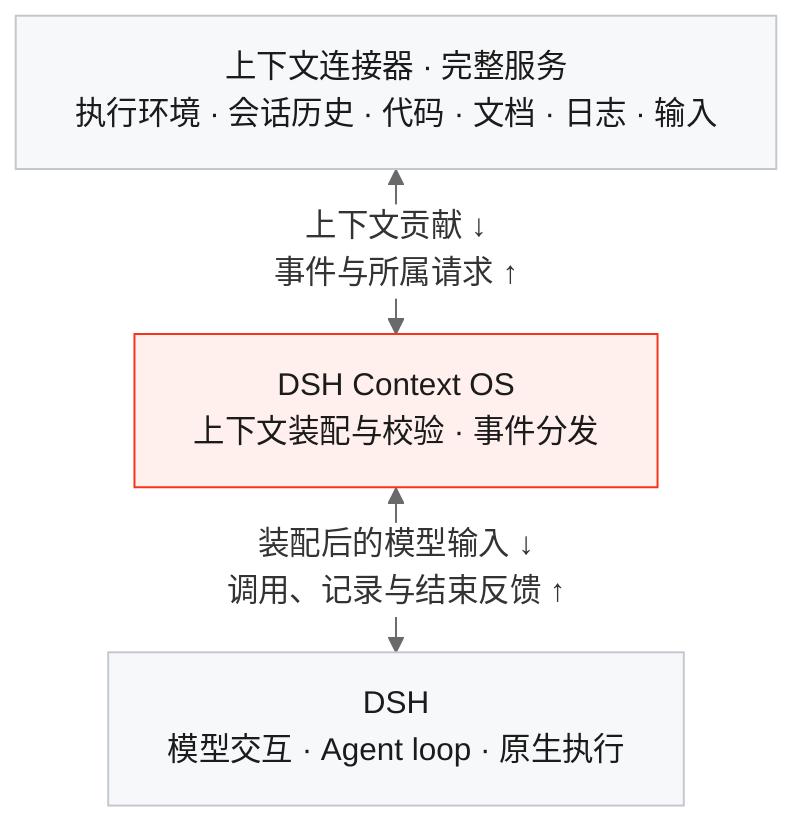

# DSH Context OS

[English](README.md) | 简体中文

> **ReAct is all you need.**  
> **Everything is a context connector.**

**用完整、可替换的资源服务，自由组合每一轮 Agent 运行。**

DSH Context OS 是 [DeepSeek Harness](https://github.com/deepseek-ai/deepseek-harness) 的插件。用户为这一轮选择执行环境、代码、会话历史、文档等服务；每个服务提供自己的上下文，处理属于自己的交互；框架围绕 Agent loop 统一装配这些贡献。

[ReAct](https://react-lm.github.io/) 将推理与行动结合。这里的 slogan 表达的是一种架构主张：保持通用的运行循环，让它与外界的连接可以自由组合。

**当前状态：**实验版 `0.2.0`。上下文组合运行和 Web 拖拽界面已经可用，完整模式通过随包启动器配合固定版本的 DSH 运行。统一资源审计、通过 Agent 对话辅助配置等能力属于下一步，详见[当前能力](#当前能力)。

## 从一轮运行出发

很多 Agent 产品围绕工作区、持久会话、技能目录或固定工具集组织能力。这些是有用的产品选择，也逐渐变成了架构里的默认前提：文件放在哪里，历史如何恢复，说明从哪里加载，外部服务怎样参与运行。

我们选择更小的基础：**一轮采用特定上下文组合的 Agent loop 运行。**

在模型和运行配置给定的情况下，模型收到的上下文，以及它能够获取的信息和资源能力，是决定产品表现的关键变量。上下文包含说明、历史、任务输入、可调用能力描述，也包含外界返回的观察结果。改善上下文，意味着在合适的时机提供合适的信息，并让 Agent 能够访问正确的资源。

由此得到两条清晰的分工：

- **框架规定上下文如何装配、事件如何交付。**
- **服务提供方决定贡献什么、何时贡献，以及自己的资源如何工作。**

一个文档平台可以完整提供使用说明、搜索、编辑、权限与持久化。输入法、日志流、历史推荐服务，也可以通过同一切面参与。Skill、MCP 仍是有用的接入形式，框架里的服务模型可以覆盖比这些形式更完整的能力。

本项目是[《以上下文装配与反馈作为框架边界》](https://github.com/weijiafu14/dsh/blob/main/articles/02-context-connectors.md)这一想法的实现。

## 三层架构，一套反馈机制



**一个 connector 对应一个完整服务。**这个服务的说明、可调用能力、执行反馈、持久化和收尾放在一起。沙箱服务贡献系统说明与文件、Shell 能力，文档服务贡献编辑说明与文档操作，都使用同一套协议。

框架负责贡献的身份、顺序、校验与装配，DSH 负责底层运行循环。实例构造和服务依赖沿用 DSH/Cordis：例如 Git 提供方依赖执行环境提供方，使用已有的依赖机制完成协作。

每个服务都通过同一条链路工作：

1. 选中的连接器初始化，贡献说明、能力，以及需要装配的合法历史。
2. 每次模型执行前，框架把各服务的当前贡献组合成下一次输入。
3. 模型请求某项操作，框架把请求交给拥有这项能力的连接器。
4. 服务操作自己的资源，返回结果，也可以贡献后续步骤需要的上下文。
5. 运行记录和收尾事件反馈给服务，由它们保存数据、完成业务收尾、释放资源；也可以为后续工作贡献上下文。

开始前的装配与运行中的反馈，使用的是同一个切面。按需获取知识、收到一条新日志、返回一次工具执行结果，都可以纳入这套机制。

## 为什么这种架构能改变产品能力

### 把执行环境作为完整服务替换

将一个 Coding Agent 从宿主机迁移到沙箱，往往很复杂：文件读写、目录检查、环境检测、Shell 执行、工作区说明散布在 Agent 的不同实现里。只把命令执行转到远端，文件检查或环境描述仍可能指向原来的宿主机。

在 Context OS 中，执行环境提供方完整拥有与这个环境有关的资源边界：

| 职责 | 环境连接器提供什么 |
| --- | --- |
| 介绍环境 | 以 system 或 user 上下文说明路径、已安装软件和运行约束 |
| 查看与修改资源 | 提供文件、目录、命令等操作的能力描述与实现 |
| 返回观察结果 | 从实际使用的环境返回结果与上下文更新 |
| 管理生命周期 | 创建或连接环境、服务端鉴权、处理取消与释放资源 |

从本地环境切换为沙箱环境，改变的是这一轮选中的服务。框架仍然装配说明、分发所属请求；契约兼容的仓库、文档服务可以继续使用，依赖关系也保持明确。

**迁移工作因此收敛到环境服务契约的实现，改动范围更小，相同场景可以复用测试。**真正的隔离、资源访问与生命周期仍由提供方实现；在 prompt 里介绍一个沙箱，不会自动产生沙箱。

### 跨机器继续同一段工作

当持久化与 resume 路径紧密嵌在 Coding Agent 内部时，换一台机器继续工作，往往要迁移本地会话文件、重建目录布局，再适配 Agent 自己的恢复逻辑。

在这里，选定的历史只是上下文的一种来源。会话提供方加载历史，将它转换为框架接受的表示，接收新记录并保存结果。后端可以是本地存储，也可以是远端会话服务。

继续工作就可以表达为：

```text
选择历史 + 选择这一轮的服务 + 执行 Agent loop
```

因此可以保留共享的历史服务，同时更换机器或执行环境；也可以从同一份起始历史出发，组合不同资源探索另一条路径。DSH 仍维护当前循环需要的运行状态，会话提供方负责持久历史从哪里来、保存到哪里去。

例如，基于这个契约实现的提供方，可以把笔记本上的运行结果保存到共享存储，再在另一台机器加载这段历史，选择云端沙箱继续工作。历史传递由会话服务负责，新执行资源的访问由环境服务负责。

可迁移的会话还必须包含合法的调用与结果关系、必要附件，以及可以解析的资源引用。这些由提供方负责。当前运行时接受一份完整、合法的原生重放历史；多个会话可以由提供方转换后作为参考上下文贡献。运行中进程迁移、多人并发写入时的同步与冲突处理，需要相应服务继续实现。

### 让用户配置“这一轮”本身

用户应当能够选择这样的组合：

| 本轮任务 | 选中的服务 |
| --- | --- |
| 修复一个 Bug | 任务输入 + 仓库 + 沙箱 + 指定历史 |
| 评审设计方案 | 任务输入 + 团队文档 + 架构知识 + 会话历史 |
| 排查线上问题 | 任务输入 + 日志来源 + 代码服务 + 事件处理历史 |
| 探索另一种方案 | 相同的起始历史 + 不同的执行环境或文档服务 |

Web 界面已经支持把可用连接器拖入本轮、编辑配置，并创建独立的 DSH 会话。开发者也可以通过核心 API 构造相同的组合。让用户通过对话请 Agent 辅助选择连接器，是后续生成这份配置的一种交互方式。

“任意组合”意味着在依赖、权限和贡献冲突规则下自由组合。已经选中的来源可以在运行中更新上下文；替换连接器集合，则创建新的组合运行。

### 让服务独立演进，让改动更容易验证

提供方可以把鉴权、权限判断、资源版本、配额和用量统计，与自己的读写操作放在一起。一个完整服务的生命周期因此有了明确归属，可以通过统一切面接入框架。

改动也更容易局部化：替换一个服务，保持其他服务不变，用同一个用户场景验证行为。仓库中的测试实际完成了这种替换：将完整资源服务从本地文件后端换成 HTTP 后端，框架和其他连接器保持不变。

架构知识服务还可以持续维护模块职责、数据流和系统约束，成为人与 Agent 共用的系统地图。服务契约与验证要求可以匹配实际的可靠性、延迟、成本要求，由人确定业务优先级和可接受的风险。

这也落实了[《未来 AI 研发体系：架构篇》](https://github.com/weijiafu14/dsh/blob/main/articles/01-architecture.md)中的工程目标：明确职责、控制影响范围、验证真实场景、持续积累可回放案例。记录输入、上下文贡献和结果，可以逐步形成回归案例库；相同配置本身并不保证模型每次输出相同。

## 看得见的组合、资源读写与上下文上限

我们希望产品在运行前、运行中、运行后都能让用户看清：这一轮选择了哪些服务，它们贡献了什么，读写了哪些资源。上下文应当和任务、模型配置一起，成为可以查看和理解的运行配置。

目前框架已经能将上下文贡献与所属调用关联到连接器实例，提供方也可以记录自己的操作。统一读写账本、跨服务计费协议，以及对任意 Shell、网络副作用的拦截，是**后续目标**。例如 Git 服务可以把 pull 标记为对远端仓库的读取，把 push 标记为写入；pull 同时可能写入本地工作副本，统计时必须明确资源归属。

上下文窗口仍然有限。连接器可以先贡献一个小索引，等需要时再获取详细内容；资源多，不意味着启动时必须把所有正文塞给模型。预算分配、信息选择与压缩策略属于运行时边界，可以随框架演进，而资源服务继续保持自己的职责。目前压缩由底层运行时提供，Context OS 尚未开放通用的预算与压缩策略插件接口。

这就是名称中 **OS** 的含义：在运行循环与资源服务之间建立共同边界，让装配策略可以演进，让服务提供方完整管理自己的能力。

## 一套小接口

连接器实现 `{ id, events, handle(event) }`。运行时提供五个事件：

| 事件 | 含义 |
| --- | --- |
| `run/initialize` | 初始化本轮组合，贡献起始上下文与历史 |
| `agent/prepare-step` | 在下一个模型步骤之前刷新上下文 |
| `tools/execute` | 执行属于本连接器的操作，并回答对应请求 |
| `session/event` | 收到已经产生的原生记录，可以保存，也可以贡献后续上下文 |
| `run/settled` | 完成本轮业务收尾；`closing: true` 还表示最终释放资源 |

来源也可以使用自己的事件名，例如 `documents/changed`、`logs/new`。日志到达是来源事件，不需要伪装成“用户发来了一条聊天消息”才能交付。

处理事件后，返回四种上下文贡献：

| 操作 | 含义 |
| --- | --- |
| `put` | 设置或更新自己拥有的当前说明、可调用能力描述或执行投影 |
| `remove` | 撤销自己拥有的当前贡献 |
| `append` | 追加输入消息；初始化时也可以提供完整的原生重放记录 |
| `answer` | 回答属于本连接器的在途请求 |

框架按角色组合说明片段，并保留调用与结果关系。片段 key 按连接器隔离，选定顺序稳定；冲突的调用名称、历史重放归属、执行投影会被拒绝。业务数据的格式转换由提供方完成。自然语言说明之间的语义矛盾，仍需要服务配置者合理处理。

当前状态的更新作用于下一次准备好的请求。`put/remove` 可能使较早位置之后的缓存失效；`append` 明确表示增加历史。已产生的记录不可改写，收尾反馈也不会悄悄开启另一轮模型运行。

假设当前运行已装配[完整文档服务示例](examples/documentService.ts)：

```typescript
const receipt = await run.send(
  'documents/changed',
  { policy: '采用更新后的评审规则。' },
  'documents',
);
await receipt.completed;
```

`send()` 始终确认事件已被接纳，`completed` 等待执行、子任务和持久化完成。完整示例把说明、按需指南、读写、记录收集、保存和释放放在同一个 connector 中。注册方式、归属、并发与宿主集成的细节见[协议参考](docs/protocol.md)。

## 当前能力

| 本版已经提供 | 需要集成方实现或后续建设 |
| --- | --- |
| 统一事件与上下文贡献、归属隔离和冲突检查 | 统一资源读写账本、任意网络与 Shell 副作用拦截 |
| DSH Web 拖拽组合器、可复用的宿主 UI | 通过 Agent 对话辅助选择连接器 |
| 原生执行工具、Skill、MCP、会话历史、子 Agent 的适配，以及 PTC 执行投影 | 面向具体生产环境的沙箱、远端会话和企业服务后端 |
| 独立框架入口与完整文档服务示例 | 通用上下文预算、压缩策略插件 |
| 已验证的更新、撤销、冷恢复、服务替换和持久化行为 | 跨机器迁移正在执行的进程、多写入方会话同步 |

Skill、MCP 适配用于承接已有集成，新服务可以直接实现连接器协议。宿主安全策略和服务方鉴权继续生效；本包不提供不可信插件代码隔离，也不会自动记录任意 Shell 命令的全部外部影响。

## 安装与运行

需要 **Node.js 24.9+**，以及已经构建好的 DSH [`22ddee3792402c3e70ec5f86a63c3e3e895a2f60`](https://github.com/deepseek-ai/deepseek-harness/tree/22ddee3792402c3e70ec5f86a63c3e3e895a2f60) 版本，版本标签为 `0.2.1-rc.3`。只匹配 npm 版本号不够。首个版本为 `dsh-context-os@0.2.0`。

从 npm 安装到兼容的 DSH Web profile：

```sh
dsh plugin --profile web add dsh-context-os@0.2.0 --ignore-scripts --config.auto-install-peers=false -w
"${DSH_HOME:-$HOME/.dsh}/profiles/web/node_modules/.bin/dsh-context-os" --dsh-root /absolute/path/to/pinned/deepseek-harness --profile web
```

[GitHub Releases](https://github.com/weijiafu14/dsh-context-os/releases) 也提供插件安装包和独立源码包。如需自行构建，在本项目源码目录运行：

```sh
DSH_SOURCE_ROOT=/absolute/path/to/pinned/deepseek-harness npm run build
npm pack
```

将生成的包安装到兼容的 DSH Web profile：

```sh
dsh plugin --profile web add /absolute/path/dsh-context-os-0.2.0.tgz --ignore-scripts --config.auto-install-peers=false -w
"${DSH_HOME:-$HOME/.dsh}/profiles/web/node_modules/.bin/dsh-context-os" --dsh-root /absolute/path/to/pinned/deepseek-harness --profile web
```

启动器在 DSH 启动前装入经过版本核对的上下文准备与接纳适配，保留原 DSH 安装文件。完整事件驱动模式通过这个启动器启用。进入 Web 后，打开 **上下文组合**，选择连接器、输入任务并开始运行。

公开入口分别是：DSH 插件 `dsh-context-os`、组合核心 `/core`、兼容适配 `/compat`、React 组合器 `/ui`。运行时 peer 包由兼容的 DSH 提供，共享 UI 支持 React 18、19。插件使用 Web/desktop 客户端契约，独立 Electron 安装发行版尚未单独验证。

## 开发与验证

```sh
DSH_SOURCE_ROOT=/absolute/path/to/pinned/deepseek-harness npm run verify
npm run export:source
```

源码包已经在集成应用之外独立构建。51 项包测试覆盖上下文组合、实际 DSH 执行、说明更新与撤销、重放、取消、持久化、运行中反馈和服务替换。需要原生适配的测试单独执行，跳过项不会被算作通过；消费方类型检查也已通过。

安装包的浏览器验证覆盖 DSH Web 拖拽、自定义提供方、Skill、MCP、冷启动历史与 PTC；同一组合器也通过了 JoyGen 的 WebSocket、运行时和存储集成验证。这些验证使用确定的模型响应与本地企业接口测试替身，实际执行运行时、工具与浏览器；不代表已经验证所有提供商或真实企业鉴权。

## 思想来源与许可

- [ReAct: Synergizing Reasoning and Acting in Language Models](https://react-lm.github.io/)
- [DeepSeek Harness: Everything is a Plugin](https://github.com/deepseek-ai/deepseek-harness)
- [以上下文装配与反馈作为框架边界](https://github.com/weijiafu14/dsh/blob/main/articles/02-context-connectors.md)
- [未来 AI 研发体系：架构篇](https://github.com/weijiafu14/dsh/blob/main/articles/01-architecture.md)

采用 [MIT](LICENSE)。DSH 派生适配保留上游许可及修改说明，见 [NOTICE](NOTICE) 和 `dist/runtime/LICENSE.dsh`。DSH Context OS 是独立的社区项目。


参考应用：[DSH COS Super-agent](https://github.com/weijiafu14/dsh-cos-super-agent)，通过完整资源服务组合出任务执行、子任务和原生 Web 管理界面。

## 0.2 的运行管理

宿主可以向连接器授予受限的 `catalog`、`start`、`send`、`wait`、`stop` 能力。子运行归父运行管理，空闲启动、输入投递、取消与清理继续使用同一套组合机制。详见[运行控制契约](docs/run-control.md)和 [Super-agent 实现](https://github.com/weijiafu14/dsh-cos-super-agent)。
